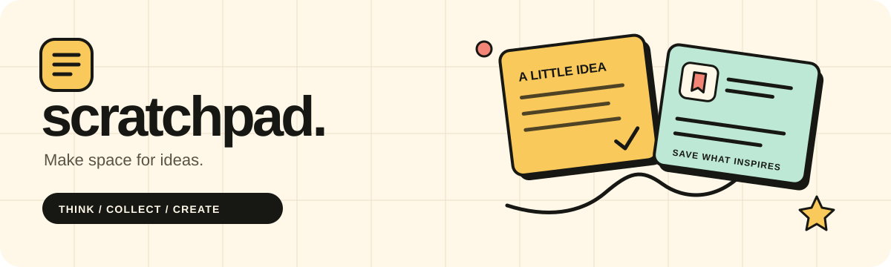

<p align="center">
  
</p>

<p align="center">
  <strong>Your ideas don't have to fit in a box.</strong><br />
  An infinite whiteboard, shared notebook, and bookmark shelf — all in one place.
</p>

<p align="center">
  <a href="https://react.dev/"></a>
  <a href="https://www.typescriptlang.org/"></a>
  <a href="https://vite.dev/"></a>
  <a href="https://supabase.com/"></a>
</p>

<p align="center">
  <a href="https://godhuber.github.io/Scratchpad/"><strong>Open Scratchpad ↗</strong></a> &nbsp;·&nbsp;
  <a href="#explore-scratchpad">Explore the tool</a> &nbsp;·&nbsp;
  <a href="#run-locally">Run locally</a> &nbsp;·&nbsp;
  <a href="#deploy">Deploy</a>
</p>

---

## A little room to think, a lot of room to grow

Scratchpad gives ideas a home before they need to be organized. Sketch a thought, pin a useful link, add a video, or invite a teammate to build on it with you.

| Create | Collect | Collaborate |
|:---|:---|:---|
| Write, draw, arrange, and zoom around an expansive canvas. | Keep bookmarks and linked media alongside your notes. | Share workspaces with owners, editors, and viewers. |

Built with React, TypeScript, Konva, Vite, Tailwind CSS, and Supabase. The app uses a hash-based router so its links work on static hosting such as GitHub Pages.

## Explore Scratchpad

### 1. Find your workspace

Sign in with email and password, or use a configured social provider. Your personal workspace is created when you first sign in. Use the navigation sidebar to move between **Workspace**, **Teams**, **Invitations**, **Bookmarks**, and **Settings**.

### 2. Put your first ideas on the canvas

- Pick **Text**, click the canvas, and write a note. Adjust its color, alignment, size, or font in the editor.
- Pick **Brush** and draw. Change the brush color and size in the toolbox.
- Choose **Select** to move items, drag a selection area, resize cards, or use the contextual controls for duplication and layers.
- Choose **Pan** to move around; use the wheel to zoom and the canvas controls to fit or reset your view.
- Use the toolbar to add image, audio, video, bookmark, and media-link cards. Double-click a media card for a larger preview.

The toolbar shows sync status. Canvas changes are saved through Supabase; keep an eye out for errors or conflicts and verify important work after reconnecting.

<details>
<summary><strong>Keyboard shortcuts</strong></summary>

| Key | Action |
|:---|:---|
| `V` / `T` / `B` / `E` / `H` | Select / text / brush / eraser / pan |
| `Esc` | Clear selection and return to select |
| `Delete` or `Backspace` | Delete selected items |
| Arrow keys | Move selected items; hold `Shift` for larger steps |
| `Ctrl` / `⌘` + `Z` | Undo a local action |
| `Ctrl` / `⌘` + `Shift` + `Z` | Redo a local action |

Shortcuts are ignored while typing in an input or text area. Undo is local, not a history of teammates' edits; verify the result before relying on it for important work.

</details>

### 3. Make a shelf of useful things

Go to **Bookmarks** to save links with titles, categories, colors, and notes. Add a bookmark to the canvas as a card, or use the toolbar to create one while you're working. The library is scoped to the current workspace.

For media, paste an HTTPS link and choose the correct type when prompted. Scratchpad supports Google Drive sharing links, direct media URLs, and YouTube/Vimeo previews. Unknown links become link cards.

> **About Drive links:** Scratchpad stores links and metadata; it does not upload files, use the Drive API, or bypass Drive permissions. Viewers must have access to the original file. Anyone with a shareable link may be able to open it outside Scratchpad. Type detection is best-effort, and a provider may block an embed; use the card's open link when needed.

### 4. Bring people in

Create a team from **Teams**, then share an invitation link or create an email-addressed invitation. Links are copied and shared by you; Scratchpad does not send invitation emails. Recipients can open the link or check **Invitations** after signing in.

| Role | What they can do |
|:---|:---|
| **Owner** | Manage the team, members and roles, transfer ownership, or delete the workspace. |
| **Editor** | Edit canvas content and invite collaborators. |
| **Viewer** | View the workspace without changing its content. |

Invitation tokens are stored as hashes. Reissuing a link rotates its token and invalidates the old link. Only share links with the people you intend to invite. Deleting a team is destructive for all its members.

### 5. Make it yours

Visit **Settings** for profile, connection, session, and auto-cleanup controls. Imported fonts can be added using an HTTPS Google Fonts stylesheet or a direct font URL; imports are saved per device, so teammates must import the font too.

Auto-cleanup ships **paused**. If enabled, the default policy marks inactive content at 60 days, moves it to Trash at 90 days, and permanently purges it at 100 days. Scheduling requires `pg_cron` or an operator-managed scheduler; see the retention migration before enabling it. Permanent deletion cannot be undone.

## Run locally

### Prerequisites

- Node.js **24** (the CI version) and npm.
- A Supabase project with the migrations applied. Use a separate development project rather than production data.

```bash
git clone https://github.com/godHUBer/Scratchpad.git
cd Scratchpad
npm ci
cp .env.example .env.local
# Edit .env.local with your Supabase project URL and publishable key.
npm run dev
```

Open the URL printed by Vite, normally <http://localhost:5173/>. The example values are placeholders. `.env.production` contains public configuration for the repository's deployment; replace it or override it for your own deployment.

> **Never put a service-role key, secret key, OAuth client secret, or admin key in a `VITE_` variable.** Vite embeds those values in the browser bundle. A publishable/anon key is public by design; database permissions and RLS are the security boundary.

### Set up Supabase

1. Create a project in the [Supabase dashboard](https://supabase.com/dashboard) and copy its URL and publishable key into `.env.local`. Older projects may use `VITE_SUPABASE_ANON_KEY` instead.
2. Apply **all** files in `supabase/migrations/` in filename order, using the Supabase CLI (`supabase link --project-ref <project-ref>` then `supabase db push`) or the dashboard SQL editor. See the [Supabase CLI documentation](https://supabase.com/docs/guides/local-development/cli/getting-started) for installation and authentication.
3. In **Authentication → URL Configuration**, set the site URL and allow the exact app URLs you use, for example `http://localhost:5173/` and `https://<owner>.github.io/<repo>/`. Add the preview origin when needed.
4. Configure email sign-in in Supabase. Confirmation emails and SMTP behavior depend on your project's settings.
5. To enable Google or GitHub sign-in, create an OAuth application with the provider and configure its credentials in **Authentication → Providers**. The provider's callback must be `https://<project-ref>.supabase.co/auth/v1/callback`; your **app URL** belongs in Supabase's redirect allowlist. The sign-in page indicates when a provider is not enabled.

The migrations cover the schema, workspace and content RPCs, invitations, RLS, Realtime, hardening, retention, team links, and admin console. Review `supabase/config.toml` and the SQL before deploying to your own project.

### Useful commands

| Command | What it does |
|:---|:---|
| `npm run dev` | Start the Vite development server |
| `npm run build` | Type-check and build for production |
| `npm run preview` | Serve the production build locally |
| `npm run lint` | Run ESLint |
| `npm run typecheck` | Run TypeScript checks |
| `npm test` | Run the Vitest suite |
| `npm run test:watch` | Run Vitest in watch mode |

For the optional browser QA harness and its setup, see [`scripts/qa/README.md`](scripts/qa/README.md). It uses a network stub and is not a substitute for database authorization tests.

## Deploy

The checked-in [Pages workflow](.github/workflows/deploy.yml) builds and deploys on pushes to `main` or manual dispatch. To use it, choose **Settings → Pages → Source → GitHub Actions** and make sure the workflow has the necessary repository permissions. It sets the Vite base path to `/<repo>/` for a project site.

For your own project, set `VITE_SUPABASE_URL` and `VITE_SUPABASE_PUBLISHABLE_KEY` as repository variables, and configure the deployed URL in Supabase Auth. **The current deploy workflow's bundle check is hard-coded to this repository's Supabase hostname**; update that check for your project before deploying an override. Review the base path too if deploying a user/organization site rather than a project site.

A separate PR CI workflow is provided at [`deployment/workflows/ci.yml`](deployment/workflows/ci.yml), but is not active until installed under `.github/workflows/`. The supplied `scripts/install-workflows.sh` copies both workflow templates into place; review them before running it because it overwrites the installed deploy workflow. Creating or changing GitHub workflow files may require additional repository permissions.

For a manual build:

```bash
VITE_BASE_PATH=/Scratchpad/ npm run build
npm run preview
```

Replace `/Scratchpad/` with your hosting base path. Publish the **contents of `dist/`**, not the source tree; GitHub Pages branch deployments need `.nojekyll` when serving files that Jekyll would otherwise omit.

## Under the hood

```text
src/
  components/       Canvas, team, settings, and UI components
  contexts/         Authentication, workspace, and toast state
  hooks/            Canvas persistence, presence, undo, and admin access
  integrations/     Supabase client and realtime channel helpers
  lib/              Link parsing, permissions, formatting, and utilities
  pages/            Application routes
  types/            Domain and database types
supabase/migrations/  Database schema, RLS, RPCs, and Realtime setup
.github/workflows/    Active GitHub Actions workflows
deployment/workflows/ Workflow templates, including optional PR CI
scripts/qa/            Optional browser QA harness
```

Content reads are scoped by workspace membership through RLS; content mutations use database RPCs with role checks. Presence uses private Realtime channels. Canvas item updates include a version check, though not every operation has the same conflict guarantees. Test authorization against a real database before trusting a new deployment.

### Admin console

The separate `/#/admin` console uses a server-side key, not a normal user login. An operator can configure or rotate it through a privileged SQL session with `public.admin_set_key(...)`; never place the real key in source control or a browser environment variable. Rotation revokes admin sessions. The browser receives an expiring session token, which can perform sensitive operations including password resets and deletion. Protect the key and browser session accordingly.

The current login limit is global: five failed attempts within 15 minutes temporarily lock out all administrators. The current `admin_list_users` SQL also references an undefined alias and needs correction before the user list can reliably load. Review and test the admin migration before relying on the console in production.

## Troubleshooting

| If you see… | Try this |
|:---|:---|
| Missing Supabase configuration | Fill in `.env.local`, then restart Vite. |
| Disabled social sign-in | Enable the provider in Supabase and configure its OAuth app and callback. |
| Sign-in returns to the wrong place | Check the exact app origin and base path in Supabase's redirect allowlist. |
| A blank page on GitHub Pages | Publish the built `dist/` output or use GitHub Actions, not the raw source branch; check the base path. |
| An inaccessible media card | Check the original file's sharing permissions, choose the right media type, or open the original link. |
| A permission error | Check your workspace role and confirm all migrations were applied. |
| Changes do not appear in another browser | Check connectivity, workspace membership, and the Realtime configuration; reload and verify saved data. |
| A Pages build fails with a custom Supabase URL | Update the hard-coded hostname check in `.github/workflows/deploy.yml`. |

## Good to know

- Media is linked, not uploaded; third-party availability and permissions still apply.
- Collaboration syncs objects, not live brush strokes. Undo is local and object rotation is not implemented.
- Large workspaces may exceed the API's response row limit; canvas reads currently do not paginate.
- The test suite does not currently exercise the SQL/RLS against a real database. Validate migrations, permissions, backups, and recovery procedures before production use.

---

<p align="center"><strong>Make a little space. See what takes shape.</strong></p>
